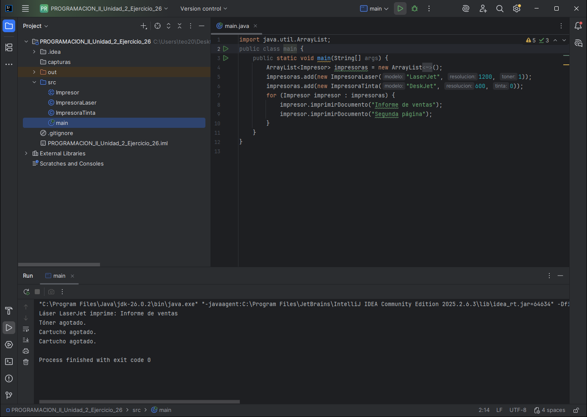

# PROGRAMACIÓN II — Unidad 2, Ejercicio 26: Controladores de Impresión y Periféricos

Trabajo práctico de Programación II. Este repositorio contiene la resolución en Java del ejercicio 26 de la Unidad 2.

## Consigna

#### Contexto

En un entorno de oficina, un ordenador puede enviar trabajos de impresión a diferentes tipos de impresoras (láser a color, chorro de tinta, matriz de puntos). La abstracción de controladores (drivers) permite que el sistema operativo envíe los mismos datos sin preocuparse por los comandos internos de cada hardware.

#### Consigna

Construir una jerarquía de clases orientada a objetos que permita gestionar impresoras de diferentes tecnologías mediante un contrato de impresión común.

#### Desarrollo requerido

- Definir una clase abstracta Impresor con atributos comunes (modelo, resolucion) y un método abstracto imprimirDocumento(String documento).
- Implementar clases concretas como ImpresoraLaser e ImpresoraTinta que extiendan la clase abstracta y añadan atributos específicos (como niveles de tóner o cartucho).
- Incorporar validaciones para que la impresión falle si los consumibles se encuentran agotados.
- En el método main, instanciar objetos de ambos tipos, ejecutar operaciones de impresión y mostrar el estado de los dispositivos por consola.

## Estructura del repositorio

```
PROGRAMACION_II_Unidad_2_Ejercicio_26/
├── README.md
├── capturas/
│   └── consola.png
└── src/
    ├── Impresor.java
    ├── ImpresoraLaser.java
    ├── ImpresoraTinta.java
    └── main.java   # clase con el método main
```

## Funcionamiento y lógica

El ejercicio usa **herencia y polimorfismo** para manejar distintos tipos de impresoras con el mismo método.

### `Impresor` (clase abstracta)

Define los atributos comunes `modelo` y `resolucion` (`protected`) y el método abstracto `imprimirDocumento(String)`, que cada impresora implementa a su manera.

### `ImpresoraLaser`

Agrega la cantidad de `toner`. Al imprimir, si queda tóner, imprime el documento y descuenta una unidad; si no, avisa "Tóner agotado".

### `ImpresoraTinta`

Agrega la cantidad de `tinta`. Si queda tinta, imprime y descuenta; si no, avisa "Cartucho agotado".

### `main`

Crea un `ArrayList<Impresor>` con una láser (con 1 unidad de tóner) y una de tinta (sin tinta), y a cada una le pide imprimir dos documentos:

- La láser imprime el primero y en el segundo avisa que el tóner se agotó.
- La de tinta avisa en los dos casos que el cartucho está agotado.

El `main` llama al mismo método en las dos impresoras, y cada una responde según su tipo.

## Ejecución

Captura de la consola de IntelliJ IDEA ejecutando el programa:



Salida obtenida:

```
Láser LaserJet imprime: Informe de ventas
Tóner agotado.
Cartucho agotado.
Cartucho agotado.
```
